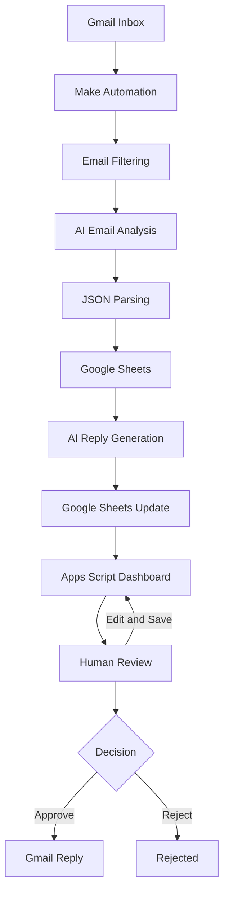

# AI Email Management Agent

An AI-powered email management assistant that automates email analysis, prioritization, summarization, action-item extraction, and reply drafting — while keeping the final decision to send an email in the hands of the user.

---

## Overview

Managing a large volume of emails can be time-consuming. Important messages may get overlooked, action items may be missed, and responding to emails can consume a significant amount of time.

The **AI Email Management Agent** is designed to streamline this process using AI-powered email analysis and automated workflows.

The system analyzes incoming emails, identifies their priority, extracts actionable information, generates contextual reply drafts, and presents them through a dashboard where the user can review, edit, approve, or reject replies.

The project follows a **human-in-the-loop approach**: AI assists with email management, but replies are not sent without explicit user approval.

## Features

- **Automated Email Analysis** – Analyze incoming emails using an AI model.
- **Email Categorization** – Categorize emails based on their content.
- **Priority Detection** – Identify the urgency of incoming emails.
- **Email Summarization** – Generate concise summaries of lengthy emails.
- **Action Item Extraction** – Identify tasks and actions requested in emails.
- **Deadline Extraction** – Identify deadlines mentioned in email content.
- **Reply Requirement Detection** – Determine whether an email appears to require a response.
- **Sentiment Analysis** – Identify the general sentiment of an email.
- **AI Reply Generation** – Generate contextual reply drafts.
- **Interactive Dashboard** – Review and manage processed emails.
- **Draft Editing** – Edit AI-generated replies before sending.
- **Human Approval** – Require user approval before sending a reply.
- **Thread-Based Replying** – Send approved replies within the original Gmail thread.

## System Architecture



## Workflow

1. **Email Retrieval** – Make monitors Gmail for incoming emails matching the configured trigger conditions.
2. **Filtering** – Emails are filtered before entering the AI processing workflow.
3. **AI Analysis** – The AI model analyzes the email and extracts structured information.
4. **Data Parsing** – The AI response is parsed into structured fields.
5. **Data Storage** – Email information and analysis results are stored in Google Sheets.
6. **Reply Generation** – AI generates a contextual reply draft where applicable.
7. **Dashboard Integration** – Email records and drafts are displayed in the dashboard.
8. **Human Review** – The user reviews, edits, saves, rejects, or approves the draft.
9. **Reply Sending** – Approved replies are sent through Gmail within the original email thread.

## AI Analysis

The system extracts the following information from emails:

| Attribute      | Description                          |
| -------------- | ------------------------------------ |
| Category       | Email classification                 |
| Priority       | Priority level of the email          |
| Summary        | Concise summary of the email         |
| Action Items   | Tasks or actions requested           |
| Deadline       | Deadline identified in the email     |
| Requires Reply | Whether a response appears necessary |
| Sentiment      | General sentiment of the email       |
| Reply Draft    | AI-generated response                |

## Dashboard

The dashboard provides a centralized interface for managing analyzed emails and AI-generated reply drafts.

### Dashboard Capabilities

- View analyzed emails.
- Review email summaries and extracted action items.
- View priority and email classification.
- Review AI-generated reply drafts.
- Edit and save reply drafts.
- Reject drafts.
- Approve and send replies.

> Screenshots of the dashboard will be added to the `docs/screenshots/` directory.

## Technology Stack

| Technology         | Purpose                                         |
| ------------------ | ----------------------------------------------- |
| Gmail              | Email retrieval and reply sending               |
| Make               | Workflow automation and orchestration           |
| NVIDIA AI          | AI-powered email analysis and reply generation  |
| Nemotron           | AI model used for processing and generation     |
| Google Sheets      | Email data storage and workflow tracking        |
| Google Apps Script | Backend logic and dashboard deployment          |
| HTML               | Dashboard interface                             |
| JavaScript         | Dashboard interaction and backend functionality |

## Project Structure

```text
AI-Email-Management-Agent/
│
├── README.md
├── LICENSE
├── .gitignore
│
├── apps-script/
│   ├── Code.gs
│   ├── Index.html
│   └── appsscript.json
│
├── automation/
│   ├── workflow.md
│   ├── error-handling.md
│   └── prompts/
│       ├── email-analysis.md
│       └── reply-generation.md
│
├── database/
│   ├── schema.md
│   └── sample-data.csv
│
├── docs/
│   ├── architecture.md
│   ├── screenshots/
│   ├── setup-guide.md
│   └── testing.md
│
└── roadmap.md
```

## Security and Human Oversight

The project is designed around human oversight and controlled email communication.

- AI-generated replies are not sent automatically.
- Users can review and modify drafts before sending.
- Email sending is handled through the authenticated Google Apps Script environment.
- Sensitive credentials and configuration values are excluded from the public repository.
- Email content is treated as external input.

Additional security, validation, reliability, and monitoring mechanisms are planned as part of the project's ongoing development.

## Setup

This repository contains the project documentation and sanitized implementation files.

To configure your own instance, the following services and configurations will be required:

- A Gmail account.
- A Google Sheets spreadsheet.
- A Google Apps Script project.
- A Make account and automation scenario.
- Access to an AI model API provider.
- Configuration of the required authorization scopes.

Detailed configuration instructions will be provided in the `docs/setup-guide.md` file.

**Do not use the repository's placeholder configuration values as actual credentials.**

## Current Status

\<details>
\<summary>Development status\</summary>

- [x] Gmail integration
- [x] Email filtering
- [x] AI email analysis
- [x] Structured JSON parsing
- [x] Google Sheets integration
- [x] AI reply generation
- [x] Dashboard integration
- [x] Draft editing
- [x] Draft rejection
- [x] Human approval workflow
- [x] Gmail reply sending
- [x] Duplicate email prevention
- [ ] Robust automation error handling
- [ ] AI output validation
- [ ] Prompt injection protection
- [ ] Processing ledger
- [ ] Monitoring and error notifications
- [ ] Production readiness testing

\</details>

## Roadmap

- Improve reliability of email processing.
- Implement duplicate email detection.
- Introduce structured error handling and recovery.
- Implement AI output validation.
- Strengthen prompt injection protection.
- Add processing logs and audit trails.
- Implement failure notifications.
- Improve monitoring and observability.
- Optimize the dashboard experience.
- Evaluate scalability and production deployment.

## Disclaimer

This project is a personal development project intended to demonstrate AI-assisted email management and workflow automation.

AI-generated analysis and replies may contain errors. Users should verify generated information before taking action or sending emails.

## License

This project is licensed under the MIT License. See the `LICENSE` file for details.
