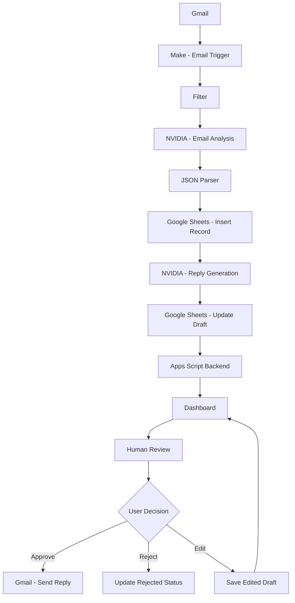

# System Architecture

## 1. Overview

The AI Email Management Agent is built using a modular architecture combining email services, workflow automation, AI processing, structured storage, and a user-facing dashboard.

The architecture separates automated email processing from human decision-making.

## 2. Architecture Components

### Email Layer – Gmail

Gmail serves as the source of incoming emails and the destination for approved replies.

Responsibilities:

- Provide incoming email data.
- Supply email and thread identifiers.
- Support replies within existing email threads.

### Automation Layer – Make

Make orchestrates the automated email-processing pipeline.

Responsibilities:

- Monitor eligible incoming emails.
- Apply filtering conditions.
- Send email content to the AI model.
- Parse structured AI output.
- Insert email records into Google Sheets.
- Trigger reply generation.
- Update email records.

### AI Processing Layer – NVIDIA

An NVIDIA-hosted AI model is used for email analysis and reply generation.

Model used:

`nvidia/nemotron-3.5-lightning-30b-a3b`

Responsibilities:

- Email categorization.
- Priority classification.
- Summarization.
- Action-item extraction.
- Deadline identification.
- Reply requirement detection.
- Sentiment analysis.
- Contextual reply generation.

### Data Layer – Google Sheets

Google Sheets acts as the central data store.

Responsibilities:

- Store email metadata.
- Store AI-generated analysis.
- Store reply drafts.
- Track email processing and approval states.
- Provide records for dashboard retrieval.

### Application Layer – Google Apps Script

Google Apps Script provides backend functionality for the dashboard.

Responsibilities:

- Retrieve email records.
- Locate corresponding records.
- Save edited reply drafts.
- Reject drafts.
- Send approved replies.
- Update email statuses.
- Manage safeguards around sending operations.

### Presentation Layer – Dashboard

The dashboard is built using HTML and JavaScript and served through Google Apps Script.

Responsibilities:

- Display email records.
- Display AI analysis.
- Present reply drafts.
- Allow draft editing.
- Save draft modifications.
- Reject drafts.
- Approve and send replies.

## 3. Data Flow

## 4. Human-in-the-Loop Architecture

The system deliberately separates AI generation from email transmission.

AI-generated replies are stored as drafts and presented to the user.

The user can:

- Review the reply.
- Edit the reply.
- Save modifications.
- Reject the reply.
- Approve the reply for sending.

The email is sent only after the user explicitly initiates the approval-and-send operation.

## 5. Security Considerations

- Credentials are not included in the public repository.
- Email content is treated as untrusted input.
- The dashboard uses server-side functionality for operations.
- Sending operations include status checks and locking safeguards.
- AI-generated information is subject to human review.
- Public examples use synthetic data.

## 6. Architecture Limitations

The current implementation is a prototype and is not yet fully production-hardened.

Planned improvements include:

- Prompt injection protection.
- Stronger AI output validation.
- Duplicate processing prevention.
- Comprehensive error handling.
- Audit logging.
- Monitoring and notifications.
- Data retention controls.

## 7. Future Architecture Evolution

The architecture may evolve to include:

- A dedicated database.
- Persistent processing ledgers.
- More robust retry and recovery mechanisms.
- Authentication and authorization improvements.
- Monitoring and alerting infrastructure.
- Additional integrations.
